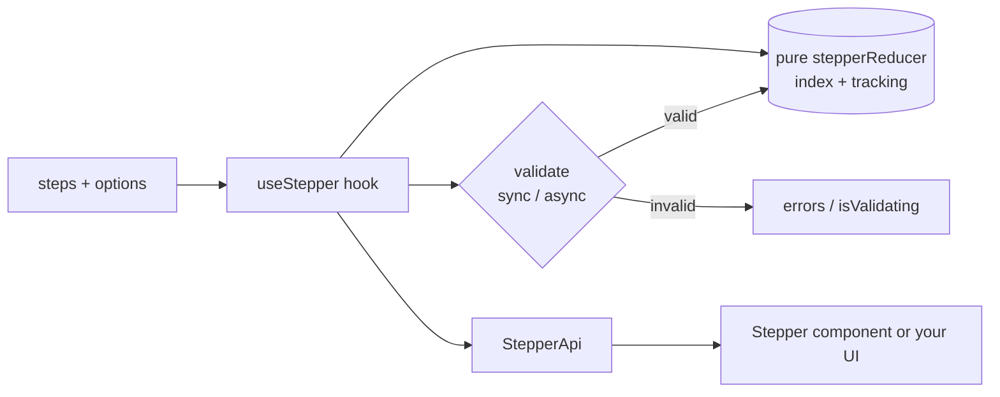

<div align="center">


# react-form-stepper

### Headless, accessible multi-step form wizard for React.

Async per-step validation, optional & skippable steps, non-linear navigation, built-in form-state collection, and four progress variants — all strict-typed, zero-dependency.

**Built and maintained by [Viprasol Tech](https://viprasol.com).**

[](https://www.npmjs.com/package/react-form-stepper)
[](https://github.com/Viprasol-Tech/react-form-stepper/actions/workflows/ci.yml)
[](LICENSE)
[](tsconfig.json)
[](https://react.dev)
[](CONTRIBUTING.md)

</div>

---

## ✨ Features

- 🧩 **Headless `useStepper` hook** — drive any UI you like; the `<Stepper />` component is just one opinionated consumer of it.
- ⏳ **Async per-step validation** — validators may be sync or async and return `boolean` or `{ valid, message }`. In-flight state is exposed as `isValidating`.
- ⏭️ **Optional & skippable steps** — mark a step `optional` to surface a Skip control and let users move on.
- 🚫 **Disabled / conditional steps** — mark a step `disabled` to remove it from the flow entirely; navigation and progress step right over it.
- 🔀 **Linear or non-linear navigation** — enforce strict order, or let users jump to any visited step (and one ahead).
- 🗂️ **Built-in form-state collection** — accumulate each step's data, keyed by step id, with deep-merge helpers; validators receive their slice.
- 📊 **Four progress variants** — `numbered`, `bar`, `dots`, `ratio`.
- ♿ **Accessible by default** — `aria-current`, `role="progressbar"`, `role="alert"` errors, `aria-busy` during async checks, keyboard-navigable step tabs.
- 🔒 **Strict TypeScript** — fully typed, generic over your form-data shape, no `any` in the public API.
- 🪶 **Zero runtime dependencies** — only React as a peer.

## 📦 Install

```bash
npm install react-form-stepper
# or
pnpm add react-form-stepper
# or
yarn add react-form-stepper
```

React 18+ is a peer dependency.

## 🚀 Usage

```tsx
import { Stepper } from "react-form-stepper";
import type { Step } from "react-form-stepper";

const steps: Step[] = [
  {
    id: "account",
    label: "Account",
    description: "Pick a username",
    // Async validator — e.g. a server-side uniqueness check.
    validate: async (data: { username?: string }) => {
      if (!data?.username) return { valid: false, message: "Username required" };
      const taken = await checkUsername(data.username);
      return taken ? { valid: false, message: "That username is taken" } : true;
    },
    content: <AccountFields />,
  },
  {
    id: "profile",
    label: "Profile",
    optional: true, // gets a Skip button
    content: <ProfileFields />,
  },
  {
    id: "review",
    label: "Review",
    content: <ReviewSummary />,
  },
];

export function SignupWizard() {
  return (
    <Stepper
      steps={steps}
      variant="bar"
      linear
      onComplete={(data) => console.log("Submit", data)}
    />
  );
}
```

### Headless: the `useStepper` hook

Build a completely custom UI while the hook owns the state machine:

```tsx
import { useStepper } from "react-form-stepper";

function CustomWizard({ steps }) {
  const s = useStepper(steps, { linear: false });

  return (
    <>
      <progress value={s.progress} max={100} />
      {steps[s.currentStep].content}
      {s.errors[s.currentStep] && <p role="alert">{s.errors[s.currentStep]}</p>}

      <button onClick={s.prev} disabled={s.isFirst}>Back</button>
      <button onClick={() => s.next()} disabled={s.isValidating}>
        {s.isLast ? "Finish" : "Next"}
      </button>
    </>
  );
}
```

## 🧭 How it works



The reducer is a pure, framework-agnostic index machine (fully unit-tested in isolation). The hook layers validation gating, optional/disabled handling, non-linear rules, and form state on top. The component is a thin, accessible renderer over the resulting API.

## 📚 API

### `<Stepper />` props

| Prop             | Type                                             | Default      | Description |
| ---------------- | ------------------------------------------------ | ------------ | ----------- |
| `steps`          | `Step[]`                                          | —            | Ordered list of steps. |
| `initialStep`    | `number`                                          | `0`          | Starting step (clamped + snapped to an active step). |
| `initialData`    | `TData`                                           | `{}`         | Initial form-data record, keyed by step id. |
| `linear`         | `boolean`                                         | `true`       | Enforce sequential completion; disable for free navigation. |
| `variant`        | `"numbered" \| "bar" \| "dots" \| "ratio"`        | `"numbered"` | Progress indicator style. |
| `clickableSteps` | `boolean`                                          | `true`       | Allow clicking step headers to navigate. |
| `onStepChange`   | `(step: number, prev: number) => void`            | —            | Fired when the active step changes. |
| `onComplete`     | `(data: TData) => void`                           | —            | Fired when the last valid step is finished. |
| `labels`         | `{ next?, prev?, finish?, skip? }`                | —            | Override control labels. |
| `renderFooter`   | `(api: StepperApi) => ReactNode`                  | —            | Custom footer render-prop. |
| `renderStep`     | `(step: Step, api: StepperApi) => ReactNode`      | —            | Custom step-content render-prop. |
| `className`      | `string`                                          | —            | Class applied to the root element. |

### `Step`

| Field         | Type                                                       | Description |
| ------------- | --------------------------------------------------------- | ----------- |
| `id`          | `string`                                                  | Stable id (React key + form-state key). |
| `label`       | `string`                                                  | Shown in the progress indicator. |
| `description` | `string?`                                                 | Optional sub-label. |
| `content`     | `ReactNode`                                               | Rendered when active. |
| `validate`    | `(data) => boolean \| {valid, message} \| Promise<...>`   | Optional sync/async gate. |
| `optional`    | `boolean?`                                                | Renders a Skip control. |
| `disabled`    | `boolean?`                                                | Removed from the flow. |
| `icon`        | `ReactNode?`                                              | Optional indicator icon. |

### `useStepper(steps, options)` → `StepperApi`

| Member            | Type                                  | Description |
| ----------------- | ------------------------------------- | ----------- |
| `currentStep`     | `number`                              | Active step index. |
| `stepCount`       | `number`                              | Total steps (incl. disabled). |
| `activeStepCount` | `number`                              | Steps participating in the flow. |
| `isFirst` / `isLast` | `boolean`                          | Boundary flags (active-aware). |
| `progress`        | `number`                              | Completion percentage `[0, 100]`. |
| `canProceed`      | `boolean`                             | Last resolved validity of the active step. |
| `isValidating`    | `boolean`                             | An async validator is in flight. |
| `isComplete`      | `boolean`                             | Every required step is done. |
| `visitedSteps`    | `readonly number[]`                   | Indices visited at least once. |
| `completedSteps`  | `readonly number[]`                   | Indices completed/passed. |
| `skippedSteps`    | `readonly number[]`                   | Indices skipped. |
| `errors`          | `Record<number, string>`              | Validation messages by index. |
| `steps`           | `readonly StepMeta[]`                 | Per-step metadata for custom rendering. |
| `formData`        | `TData`                               | Accumulated data, keyed by step id. |
| `next`            | `() => Promise<boolean>`              | Validate + advance. Resolves to whether it moved. |
| `prev`            | `() => void`                          | Go back one active step. |
| `goTo`            | `(step: number) => Promise<boolean>`  | Jump (gated by `linear`). |
| `skip`            | `() => void`                          | Skip an optional step. |
| `reset`           | `() => void`                          | Restart and clear tracking. |
| `setStepData`     | `(data) => void`                      | Merge into the active step's slice. |
| `setFormData`     | `(data: TData) => void`               | Replace the whole record. |
| `getStepData`     | `(stepId: string) => unknown`         | Read a step's slice. |
| `setError`        | `(step: number, message?) => void`    | Set/clear an error imperatively. |

## ✅ Roadmap

- [x] Async per-step validation with error messages
- [x] Optional / skippable & disabled steps
- [x] Non-linear navigation
- [x] Progress variants (numbered, bar, dots, ratio)
- [x] Form-state collection
- [ ] Persisted state (localStorage / URL) adapter
- [ ] Animated step transitions
- [ ] Vertical orientation preset
- [ ] First-class integration recipes for React Hook Form & Zod

## ❓ FAQ

**Is it controlled or uncontrolled?**
`<Stepper />` is uncontrolled and manages its own state via `useStepper`. For full control, use the hook directly and render your own UI.

**Can validators be asynchronous?**
Yes. Return a `Promise`; the stepper awaits it and reports `isValidating` while it runs. Return `{ valid, message }` to surface an inline error.

**How do I collect data across steps?**
Call `setStepData(partial)` inside a step (it deep-merges object slices into `formData[stepId]`). Read it all from `formData`, or per-step via `getStepData(id)`. Validators receive their own slice.

**Does it ship styles?**
No CSS framework is required. The component uses minimal inline layout and exposes `data-status`, `data-variant`, and `className` hooks so you can style it however you want.

**Tree-shakeable / SSR-safe?**
Yes — it's a tiny ESM package with no runtime dependencies and no direct DOM access at import time.

## 🤝 Contributing

Contributions are welcome! Please read [CONTRIBUTING.md](CONTRIBUTING.md) and our [Code of Conduct](CODE_OF_CONDUCT.md). To get started:

```bash
npm install
npm run typecheck
npm test
```

## Contact — Viprasol Tech Private Limited

- Website: [viprasol.com](https://viprasol.com)
- Email: [support@viprasol.com](mailto:support@viprasol.com)
- Telegram: [t.me/viprasol_help](https://t.me/viprasol_help) | WhatsApp: +91 96336 52112
- GitHub: [@Viprasol-Tech](https://github.com/Viprasol-Tech) | [LinkedIn](https://www.linkedin.com/in/viprasol/) | X [@viprasol](https://twitter.com/viprasol)

## License

[MIT](LICENSE) (c) 2025 Viprasol Tech Private Limited
